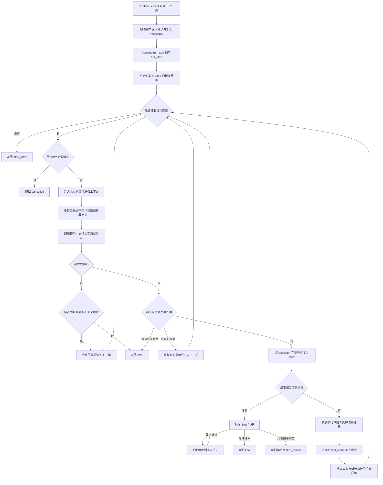

# Agent Loop：从收到任务到结束的完整流程

本文依据当前 `agent/loop.py` 及其调用方整理，按实际执行顺序讲解。
重点是：每一步拿到什么、做什么、接下来进入哪个分支。

核心关系是：**模型决定下一步，Loop 管理过程，工具执行具体操作，Hooks 决定是否允许执行或结束。**

## 1. 先区分四个概念

| 概念 | 在本项目中的意思 |
|---|---|
| 用户请求 | 你输入的一项任务，例如“修改端口并运行测试” |
| 一次 Loop | 调用一次 `run_loop()`，直到正常结束、失败、取消或用完轮数 |
| Loop 中的一轮 | 外层 `for turn` 的一次迭代；通常请求一次模型，恢复流程也占轮数 |
| 工具调用 | 模型返回一个 `tool_use`，宿主程序据此调用对应工具 |

一轮模型响应可以带多个工具调用，因此“轮数”不等于“工具调用数”。
摘要、记忆、目标评估还可能额外调用模型，因此 Loop 的轮数也不等于所有 API 调用总数。
一次用户请求在等待队友等外层流程中，也可能触发不止一次 `run_loop()`。

## 2. 全流程图



图中省略了部分位置的取消检查，下文逐步说明。

## 3. 第 0 步：Runtime 接收用户任务

入口是 `agent/runtime.py` 的 `Runtime.submit(request)`。

普通任务依次执行：

1. 增加用户请求计数。
2. 调用 `goal.begin_query()`，初始化本次请求的目标续轮状态。
3. 保存 `active_request`，让压缩时知道当前任务。
4. 清空本次请求的记忆选择缓存，后续有需要时重新选择。
5. 触发 `UserPromptSubmit` 钩子；目前默认实现不做额外处理。
6. 把用户输入加入 `self.messages`。
7. 调用 `Runtime.run_turn()`。

例如：

```python
messages.append({
    "role": "user",
    "content": "把服务端口改成 8081，并运行测试。",
})
```

`:goal`、`/goal` 属于特殊入口，先交给目标命令处理；设定新目标后也会调用 `submit()` 执行。

## 4. 第 1 步：把运行环境传给 run_loop

`Runtime.run_turn()` 主要负责接线，把这些对象传进去：

| 参数 | 用途 |
|---|---|
| `llm` | 请求真实模型或离线 Mock |
| `registry` | 当前可用工具的注册表 |
| `messages` | 本次处理的对话列表，通常是主会话历史 |
| `system` | 主 Agent 传入 `build_system` 函数，每轮重新构建系统提示词 |
| `ctx` | 工具运行环境：工作目录、调用者、运行时、额外状态等 |
| `hooks` | 工具前后、停止等钩子的注册表 |
| `max_turns` | 本次 Loop 的迭代上限 |
| `compactor` | 上下文压缩器 |
| `active_request` | 当前用户请求 |
| `before_call` | 主 Agent 用于在每轮注入队友消息 |

TUI 开启时，还会把界面事件回调和取消标记放入 `ctx.extra`。

`messages` 会原地更新。例如：

```python
messages[:] = compactor.prepare(messages, active_request)
```

这里保留列表对象本身，替换列表内容，让 Runtime 继续持有更新后的历史。

## 5. 第 2 步：初始化本次 Loop 的状态

进入 `run_loop()` 后，先准备：

- `LoopResult()`：最终结果，包括正文、轮数、工具调用数、结束原因和错误信息。
- `ToolRecovery()`：本次 Loop 的工具重试、模型修正计数及文件状态检查规则。
- `CommandFeedback()`：识别命令失败，生成下一轮诊断提醒。
- `reactive_retries`：连续上下文超限后的应急恢复计数。
- `incomplete_retries`：连续不完整响应的恢复计数。
- `recovery_note`：提醒模型修复不完整响应的附加系统提示。
- `command_note`：提醒模型诊断失败命令的附加系统提示。

这些恢复对象是本次 `run_loop()` 的局部状态；新调用一次 Loop 会重新创建。

函数外的 `@traced_loop` 装饰器会在启用诊断时记录 Loop 开始、结束，并包装模型调用统计。

## 6. 第 3 步：进入新一轮，先检查取消

循环大致是：

```python
for turn in range(1, max(1, max_turns) + 1):
    if cancelled():
        return cancel_result()
```

如果用户已经按下停止键，直接返回 `cancelled`，不再开始这一轮工作。
否则更新轮数，并记录本轮开始。

默认配置中的 `AGENT_MAX_TURNS` 是 150，但可以被环境配置或调用方覆盖。
工具调用失败、应急压缩、Stop 要求继续、不完整响应恢复，都可能导致下一次迭代，消耗这一上限。

## 7. 第 4 步：先补充模型还不知道的新消息

执行：

```python
if before_call is not None:
    before_call(messages)
```

主 Agent 传入的是 `Runtime._inject_team_events()`。
它读取主 Agent 收件箱，把队友发来的进度、计划或结果放进对话历史。

例如：

```text
队友刚完成组件开发并发来消息
    ↓
主 Agent 下一轮读取信箱
    ↓
消息加入 messages
    ↓
模型这一轮能够看到队友的结果
```

只有调用方传入 `before_call` 才会执行这一步；共享同一个 Loop 函数不代表每个 Agent 都自动读取主 Agent 信箱。

## 8. 第 5 步：在请求模型前准备上下文

如果传入了压缩器，调用：

```python
messages[:] = compactor.prepare(messages, active_request)
```

当前五阶段的主要顺序如下。**这些触发阈值按字符或消息条数判断，不是 token。**

| 阶段 | 当前规则 | 做什么 |
|---|---|---|
| 1. 工具结果预算 | 最新批次预算 300,000 字符，单个大结果阈值 50,000 字符 | 必要时把大结果保存到磁盘，提供路径和预览 |
| 2. 消息裁剪 | 超过 200 条消息 | 归档并裁剪中段，保留头部、约 120 条尾部及工具配对 |
| 3. 微压缩 | 前两步后，消息序列化长度超过 160,000 字符 | 把已读旧工具结果换成磁盘指针，保留最近 12 个已读结果 |
| 4. 大结果缩减 | 第 3 步后仍超过 160,000 字符 | 优先缩减最大的工具结果，可能包含模型还未读过的新结果 |
| 5. 历史摘要 | 第 4 步后仍超过 160,000 字符 | 先归档，再调用模型总结，将历史替换为摘要消息 |

阶段 3、4 的缩减目标是 128,000 字符，即阈值的 80%；进入下一阶段的判断仍是是否超过 160,000。
因此并非每次准备上下文都会执行五层，也不是一定要缩到 128,000 才能继续。
消息裁剪会保护工具调用与结果的配对，实际保留条数可能略有变化。

统计 API token 与这里的压缩触发逻辑是两件事。`estimate_chars()` 只测量 `messages` 的 JSON 字符长度，不包含完整系统提示词和工具定义，也不是供应商的精确输入 token 数。

## 9. 第 6 步：组装本轮系统提示词和工具定义

先执行：

```python
system_prompt = system() if callable(system) else system
```

主 Agent 传入函数，所以每轮可以拿到最新的工作目录、工具名、计划、技能目录、队友状态、记忆及目标信息。
启用记忆时，相关记忆选择按本次用户请求缓存，不是每轮都重新选择。

随后把 `recovery_note`、`command_note` 追加到本轮系统提示词。
它们不是用户新发了一条任务，也不会因此另外增加一个 Loop。

再执行：

```python
tools = registry.definitions()
```

每轮都重新读取工具定义。例如模型先调用 `connect_mcp` 注册新工具，下一轮就能看到它们。
发给模型的是工具的名称、描述和参数 Schema；Python 处理函数由注册表保留，在宿主中执行。

## 10. 第 7 步：调用模型

统一入口：

```python
response = llm.create(
    system=system_prompt,
    messages=messages,
    tools=tools,
    max_tokens=ctx.settings.max_tokens,
    **stream_args,
)
```

`max_tokens` 限制的是单次响应输出，不是整个任务的累计用量。
当前默认输出上限为 8,000，可以配置。

如果有界面事件接收者且客户端支持流式，会额外传入：

```python
on_text = ...        # 接收公开文字片段
should_cancel = ...  # 检查是否要求停止
```

流式显示路径：

```text
SDK 收到 text_delta
    → on_text(text)
    → Loop 发送 UIEvent
    → TUI 的线程安全队列
    → 界面追加文字
```

界面只接收公开文字，不显示模型 thinking 或未完成的工具 JSON。
SDK 收到 `message_stop` 后才接受最终响应；中途断流不会接受其中的工具调用。
**先显示文字，不等于已经确认任务完成；工具仍等待完整响应及后续检查。**

模型请求成功返回后，`reactive_retries` 重置为 0。
供应商 SDK 还可以在自己的请求层处理部分暂时性网络或 HTTP 错误；这与 Loop 的恢复计数不同，不能理解成任何断流都会自动完整重跑。

## 11. 第 8 步：请求失败时，判断能不能应急压缩

如果模型调用抛出异常，先检查是否已经取消；取消则返回 `cancelled`。

否则只有同时满足以下条件才走应急压缩：

1. 传入了压缩器。
2. 异常被 `is_prompt_too_long()` 识别为上下文超限。
3. 连续应急恢复尚未超过 1 次。

恢复流程：

```text
保存完整历史 → 总结较早部分 → 保留最近约 5 条消息并保护工具配对 → 下一轮重试
```

这里使用 `reactive_compact()`，和一般的五阶段阈值触发不同。
一旦模型成功响应，连续计数会重置；因此“最多 1 次”是指连续超限恢复，不是整个会话最多压缩一次。

不满足恢复条件时，返回 `error`。Loop 不会仅因 `LLMError.retryable=True` 就自行无限重试。

## 12. 第 9 步：检查模型响应是否完整

先取出工具调用、正文和供应商的 `stop_reason`。
这时会发送 `model_end` 界面事件，然后再处理响应分支；事件名表示请求返回，不表示任务验收通过。
如果已取消，则不继续接收这次响应到历史中，也不执行其中工具。

### 情况 A：带工具调用，但输出因 max_tokens 被截断

整条响应不加入历史，其中所有工具调用均不执行。
程序准备恢复提示，要求下一轮重新生成一个更小、更完整的调用。
之前已经完成的工具不会因此撤回。

### 情况 B：没有工具调用，正文为空或只有 thinking

不当成最终答案，也不把空响应放回历史。
准备恢复提示，进入下一轮，让模型给出具体工具调用或简洁回答。

### 情况 C：没有工具调用，有正文，但正文因 max_tokens 被截断

保留已有正文到历史，再追加一条“回答被截断，请继续”的提示。
下一轮继续，不直接触发正常结束。

以上情况共用最多 2 次连续恢复机会，同时受总轮数上限约束。
拿到可正常处理的响应后，`incomplete_retries` 和 `recovery_note` 清零。

## 13. 第 10 步：把可处理的模型响应加入历史

```python
messages.append({"role": "assistant", "content": response.content})
```

这里保存完整内容块，包括需要回传的工具调用及模型字段，而不只是屏幕上显示的文字。

接下来分成两条路线：

- **有工具调用**：执行工具批次。
- **没有工具调用**：模型提出结束，进入 Stop 钩子。

## 14. 第 11A 步：没有工具调用，触发 Stop 钩子

```python
forced = hook_registry.trigger(STOP, messages)
```

`Hooks.trigger()` 按注册顺序执行，遇到第一个非 `None` 返回值就停止。
主 Runtime 的 Stop 顺序是：**目标检查在前，记忆提取在后。**

### 目标检查

没有活动目标，或处理的不是主会话历史时，目标钩子不干预。
有主目标时调用独立评估器，可以得到：

| 情况 | 接下来做什么 |
|---|---|
| 达到目标 | 目标钩子返回 `None`，继续检查后面的 Stop 钩子 |
| 未达到且允许继续 | 返回 `StopDirective("continue", 原因)`，Loop 把原因加入历史，下一轮继续 |
| 队友尚在做关联任务 | 返回 `goal_defer` 状态，把控制权交回外层 |
| 评估失败、无法完成或续轮耗尽 | 返回相应 `goal_*` 状态 |

目标续轮默认上限为 8，与 `max_turns` 是不同预算；目标评估也可能误判，不能替代独立测试。

### 记忆提取

若前面的目标钩子没有拦截，且记忆功能开启，则提取可长期保存的信息，必要时整合记忆。
这是在模型提出停止时、Loop 返回之前执行，不是每次工具调用后执行。
提取异常会被捕获，不应因为记忆失败破坏当前回答。

### Loop 如何处理钩子结果

- `StopDirective("continue")`：加入继续原因，再迭代。
- `StopDirective("return")`：返回指定结束状态。
- 其他真值结果：转成字符串加入历史，再迭代。
- 无阻止结果：设置 `stop_reason="final"`，返回正文。

因此，**模型没调用工具并不代表立即退出；还需要经过 Stop。**

## 15. 第 11B 步：有工具调用，执行本批工具

模型可以一次返回多个工具调用。本项目这里用普通 `for` 逐个执行，**同一批工具在本 Loop 内顺序执行，并非并行执行**。
后台队友可以在各自线程中并行工作，那是另一个层面的并行。

每个调用进入统一入口：

```python
output = execute_tool(block, registry, ctx, hooks, recovery)
```

### 15.1 识别调用及恢复计数目标

读取 `block["name"]`、`block["input"]`，非字符串工具名替换为安全占位值。
`recovery.key()` 按调用者、工作目录、工具名和目标生成身份，文件路径会尽量规范化。
这些信息用于同一工具/目标的失败计数，不是完整参数的哈希；审计事件另有参数哈希。

### 15.2 清除旧临时权限，检查恢复规则

清理 `ctx.extra["allow_outside"]`，保证上一次路径越界批准不泄漏到这次调用。
然后调用 `recovery.exhausted(key)`：

- 同一文件上次写入结果未知：返回 `STATE_CHECK_REQUIRED`，先检查真实文件状态。
- 同一工具/目标的模型修正预算耗尽：返回 `RECOVERY_EXHAUSTED`。

### 15.3 校验工具和参数

未被恢复规则拦住时，执行 `registry.validate(name, args)`，检查：

- 工具是否存在。
- 参数是否为 JSON 对象，键与值是否为合法 JSON 数据。
- 是否满足该工具的 JSON Schema，如必填项和类型。

失败则记录 `validation` 事件，调用 `observe()` 更新状态后返回。
**校验不通过时还没有执行工具，也没有进入执行工具的自动重试循环。**

### 15.4 执行前钩子：权限与计划门

进入程序尝试循环后，每次尝试都重新触发 `PreToolUse`。
主 Agent 主要检查权限；后台队友还可以先检查计划是否批准。

钩子返回非 `None` 就阻止调用。已有结构化结果直接使用，普通原因字符串包装成 `POLICY_BLOCKED`。
该分支记录 `permission` 事件后返回，不会通过自动重试绕过审批。

### 15.5 注册表分发到真实处理函数

```text
registry.dispatch(name, args, ctx)
    → 再次校验
    → 找到 Tool.handler
    → handler(args, ctx)
    → 转成 ToolResult
```

例如 `read_file` 读取文件，`edit_file` 替换文件内容，`bash` 执行命令。
处理函数中的普通异常会在 `dispatch()` 中转成结构化失败结果，而不是直接让整个 Loop 崩溃。
`finally` 再次清理临时路径权限。

### 15.6 执行后钩子及程序自动重试

工具返回后触发 `PostToolUse`，再由 `can_retry()` 判断是否允许程序自动重试。
必须同时满足：工具存在、`read_only=True`、`retry_safe=True`、结果标记为暂时故障、仍有重试额度，且不是权限或参数错误。

默认是**首次执行 + 最多 2 次重试，共最多 3 次处理函数执行**。
重试前随机退避等待，每次仍重新走 `PreToolUse`。
这些内部重试不要求模型重新生成工具调用，也不单独消耗外层 Loop 轮数。
`bash` 及写入操作不因为失败就默认自动重放。

### 15.7 更新恢复状态，再返回结果

最终不再自动重试时，执行 `recovery.observe(key, output)`：

- 成功：清除该工具/目标的修正失败计数。
- `INVALID_ARGUMENT`、`UNKNOWN_TOOL`、`NOT_FOUND`、`PRECONDITION_FAILED`：失败计数加一。
- `write_file` / `edit_file` 失败且结果未知：把该文件标成需要检查。
- `read_file` 完整读到文件，或确认文件不存在，并提供 `inspected_path`：解除对应文件的未知状态标记。

读取一小段文件不一定能解除标记；必须由读取工具提供完整检查证据。
未知文件状态集合跨 `write_file` / `edit_file` 两种修改工具检查，但不等于所有命令副作用都有事务保证。

模型修正预算默认是首次失败后再给 2 次机会；第 3 次同类失败被计入后，后续同一工具/目标会被拦截。
改变目标可能改变计数身份；它不是整个任务的全局失败次数上限。

## 16. 第 12 步：回传工具结果，准备下一轮

每个结果被转换成：

```python
{
    "type": "tool_result",
    "tool_use_id": "对应的工具调用编号",
    "content": output.model_content(),
    # 失败时另外设置 is_error=True
}
```

成功结果通常是文本；失败结果带错误码、原因、执行状态及下一步建议。
Loop 把本批所有结果放在同一个 `user` 消息里：

```python
messages.append({"role": "user", "content": results})
```

这里 `role="user"` 是 API 表达工具结果的消息格式，不表示用户亲自说了这些内容。
`tool_use_id` 用来让模型知道每个结果对应哪个调用。

### 命令失败提醒

`CommandFeedback.observe()` 针对 `bash` 的 `COMMAND_FAILED` 生成有界诊断提醒：先看退出码、stdout、stderr，再查失败断言和实现。
同一命令参数与同一可见错误重复出现时，提醒换一种诊断方式。
提醒放到下一轮系统提示词，不会自行修改命令、执行命令或阻止工具。

### 模型修正发生在这里之后

```text
工具返回 INVALID_ARGUMENT
    → 错误作为 tool_result 加入历史
    → 下一轮模型看到错误
    → 模型重新选择工具或修改参数
    → 再次进入 execute_tool
```

这就是模型修正，与 `execute_tool()` 里的程序自动重试不同。

## 17. 第 13 步：工具批次结束，再检查取消和手动压缩

先检查取消。如果已经取消，保留已完成工具结果，返回 `cancelled`。
如果取消发生在批次中，尚未执行的工具会补上 `CANCELLED` 结果，再一起加入历史，避免留下无法配对的工具调用。

随后检查 `COMPACT_FLAG`：模型调用 `compact` 工具时只设置标记，等本批结果写入历史后才真正执行 `compact_history()`。

这样设计是因为同批可能还包含 `write_file` 等工具；必须先记录它们的执行结果，再摘要替换历史。
手动压缩不要求先超过五阶段阈值，但要求有可用且启用的压缩器。

最后进入下一轮，再次执行：补充消息、准备上下文、构建提示词、调用模型。

## 18. 第 14 步：结束并把结果交回外层

结束状态主要有：

| `stop_reason` | 含义 |
|---|---|
| `final` | 有正文、无工具调用，且 Stop 钩子允许正常返回 |
| `max_turns` | 迭代用完，仍未得到正常最终回答 |
| `error` | 模型调用失败，或不完整响应恢复耗尽等 |
| `cancelled` | 用户要求停止，Loop 已在可检查的位置退出 |
| `goal_*` | 目标评估决定暂缓、失败、异常或达到续轮限制等 |

`LoopResult.ok` 只判断 `stop_reason == "final"`，不证明代码、答案或测试正确。
轮数上限也不是精确的累计 token 或金额预算。

`Runtime.run_turn()` 累计主流程的轮数和工具数。
`Runtime.submit()` 收集压缩、记忆等备注，格式化结果，再交给 CLI 或 TUI。
TUI 和单次团队任务的外层等待逻辑，还可能读取队友消息，再调用 `run_turn()` 接着工作。

## 19. 用一个例子把流程串起来

任务：**“把配置端口改成 8081，并运行测试。”**

```text
收到任务 → 保存用户消息 → 初始化 Loop

第 1 轮：
  准备上下文，模型决定 read_file("config.py")
  → 参数校验 → 权限检查 → 读取 → 回传内容

第 2 轮：
  模型看到文件，决定 edit_file(...8080 → 8081...)
  → 参数校验 → 权限检查 → 修改 → 回传结果

第 3 轮：
  模型决定 bash("运行项目测试")
  → 命令失败 → 结果与诊断提醒留给下一轮
  → 此处不默认自动重跑 bash

第 4 轮：
  模型检查失败断言或相关文件
  → 找到原因 → 后续轮次修复并重新验证

后续某轮：
  模型回答修改内容与测试结果，不再提出工具调用
  → Stop 检查
  → 要求继续：带原因进入下一轮
  → 允许结束：返回 final
```

这是流程示例，不表示程序硬编码了这些固定轮次；实际工具和顺序由模型根据任务与结果选择。

## 20. 主 Agent、子 Agent 和后台队友有什么相同与不同

三者复用 `run_loop()`，因此基本响应检查、工具执行和结束分支相同，但接线不同：

| 调用者 | 对话与运行方式 | 当前主要接线差异 |
|---|---|---|
| 主 Agent | 主会话历史 | 动态系统提示词、队友消息注入、压缩器、主目标及记忆钩子 |
| 一次性子 Agent | 新建独立消息列表，在父工具调用中嵌套执行 | 使用受限工具池，继承传入钩子；当前不传压缩器，也不传主信箱注入回调 |
| 后台队友 | 独立上下文与线程 | 使用队友工具池及计划门、权限钩子；当前 `Runtime.loop_runner()` 不传压缩器 |

因此不能说“所有 Agent 都有完整相同的五层压缩、记忆与目标检查”。
一次性子 Agent 的目标钩子会通过消息列表身份识别，避免代替主 Agent 判定主目标。

## 21. 取消、显示、诊断的边界

取消是协作式检查，不是随时杀死线程：当前阻塞的网络读取或命令可能要先返回。
已经写入的文件不会因为取消自动回滚。

`UIEvent` 用于界面显示，包括模型开始、文字片段、工具开始、工具结束等。
`on_event` 还承担现有调度通知，`on_progress` 用于普通终端状态，它们不能随意混用。
诊断日志单独记录轮数、调用、耗时、错误码、参数哈希和供应商 token，不把界面事件塞进模型历史。

TUI 工具卡片最多预览 8,000 字符，不代表工具只给模型返回这些字符。
模型正文流式显示与命令 stdout 流式输出也是两回事；目前 `bash` 仍等命令结束再返回。

## 22. 阅读代码时的定位顺序

| 想看什么 | 代码位置 |
|---|---|
| 用户输入、接线、目标与记忆钩子 | `agent/runtime.py`：`submit`、`run_turn`、`build_system`、`_install_hooks` |
| 主循环与统一工具入口 | `agent/loop.py`：`run_loop`、`execute_tool` |
| 参数校验及处理函数分发 | `agent/tools/registry.py`：`validate`、`dispatch` |
| 程序重试、模型修正计数、未知文件状态 | `agent/tools/recovery.py`：`ToolRecovery` |
| 工具结构化结果 | `agent/tools/result.py`：`ToolResult` |
| 命令失败诊断提示 | `agent/tools/feedback.py`：`CommandFeedback` |
| 钩子如何注册与按顺序触发 | `agent/events.py`：`Hooks`、`StopDirective` |
| 五阶段、手动与应急压缩 | `agent/context.py`：`prepare`、`compact_history`、`reactive_compact` |
| 模型 API、流式响应、标准化结果 | `agent/llm.py`：`AnthropicLLM.create`、`normalize_response` |
| 独立目标评估与续轮预算 | `agent/goal.py`：`GoalController.judge` |
| Loop 与 API 诊断包装 | `agent/diagnostics.py`：`traced_loop`、`ObservedLLM` |
| 线程事件队列、审批窗口与界面 | `agent/tui.py`、`agent/ui_events.py` |
